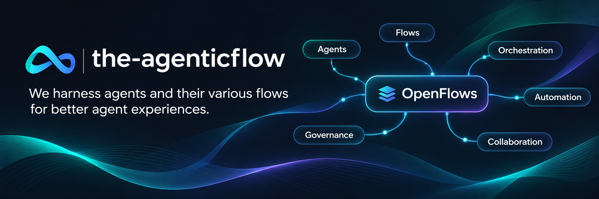

# The-AgenticFlow

We build tools for agent coordination, orchestration, and automation. **OpenFlows** is our flagship project: an autonomous AI development team that turns GitHub issues into reviewed pull requests in self-hosted Coder workspaces.

## Pinned repositories

- **[openflows](https://github.com/The-AgenticFlow/openflows)** — Agent coordination from planning through review and delivery.
- **[openflows-console](https://github.com/The-AgenticFlow/openflows-console)** — Control panel for agents, workspaces, tasks, and system health.
- **[openflows-cli](https://github.com/The-AgenticFlow/openflows-cli)** — Terminal interface for OpenFlows.
- **[agent-harness](https://github.com/The-AgenticFlow/agent-harness)** — Harness for OpenFlows agents.
- **[workspace-runtime](https://github.com/The-AgenticFlow/workspace-runtime)** — Versioned agent workspace image and role assets.
- **[openflows-website](https://github.com/The-AgenticFlow/openflows-website)** — Website for OpenFlows.

## Get started

Follow the [OpenFlows quick start](https://github.com/The-AgenticFlow/openflows/blob/develop/quick_start.md), or visit [openflows.dev](https://openflows.dev) to learn more.

Have an idea or found a problem? [Open an issue](https://github.com/The-AgenticFlow/openflows/issues) or contribute a pull request to the relevant project.
